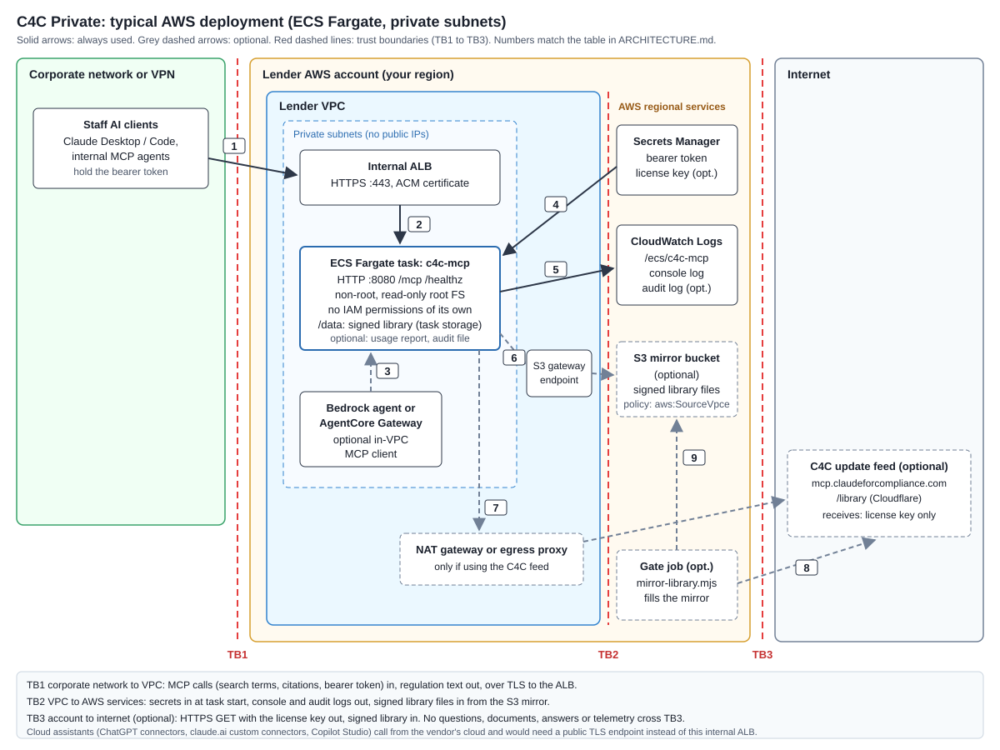
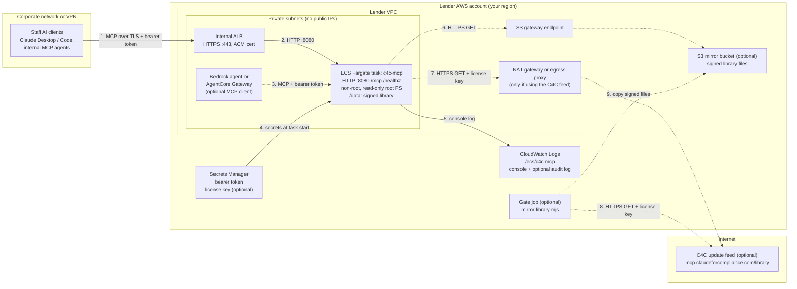

# C4C Private: architecture and trust boundaries (AWS)

Research use only. C4C returns regulatory text and citations. It is not legal advice.

This page shows a typical deployment of the C4C self-hosted MCP server in a lender's AWS account: an ECS Fargate task in private subnets behind an internal Application Load Balancer. The same container runs on EKS (Helm chart), Azure Container Apps, AKS or any Docker host; the trust boundaries are the same.

Image: `ARCHITECTURE-aws.svg` (same content as the Mermaid diagram below).

## Components

| Component | Who runs it | Role |
|---|---|---|
| AI clients (Claude Desktop or Code, internal agents) | Lender | MCP clients. Send tool calls with the bearer token. Hold the user's documents and prompts; C4C never sees those. |
| Bedrock agent or AgentCore Gateway (optional) | Lender | An MCP client inside or connected to the VPC. Model calls it makes are governed by your Bedrock configuration, not by C4C. |
| Internal ALB | Lender | Terminates TLS (ACM certificate). Forwards to the task on HTTP 8080. Optional ALB access logs are yours. |
| ECS Fargate task `c4c-mcp` | Lender (image from CF Synergies) | MCP server on `/mcp`, health on `/healthz`. Non-root, read-only root filesystem, no IAM permissions of its own. Library in `/data` on task storage. |
| Secrets Manager | Lender | Holds the bearer token and, only if using the C4C feed, the license key. The ECS task execution role reads them at task start and injects them as environment variables. |
| CloudWatch Logs | Lender | Receives the container's console output through the `awslogs` driver (`/ecs/c4c-mcp`), including the optional audit log in `stdout` mode. |
| S3 mirror bucket (optional) | Lender | Holds signed library files. Reached through an S3 gateway endpoint; bucket policy allows `s3:GetObject` only from that endpoint. |
| Gate job (optional) | Lender | Runs `server/mirror-library.mjs` from the same image to copy signed releases from the C4C feed into the S3 mirror. Holds the license key. |
| NAT gateway or egress proxy (optional) | Lender | Needed only if the task itself fetches from the C4C feed. |
| C4C update feed (optional) | CF Synergies (Cloudflare Worker and R2) | Serves `manifest.json`, `manifest.sig` and `<version>/corpus.sqlite.gz` over HTTPS to holders of a license key. |

## Diagram (Mermaid)

## Data flows

| # | From, to | Protocol | What crosses | Notes |
|---|---|---|---|---|
| 1 | AI clients to internal ALB | HTTPS (your certificate) | MCP JSON-RPC: tool name, search terms, citations, section ids, quotes to verify; bearer token. Back: regulation text, citations, version and currency fields, `library` block. | Crosses TB1. Documents and prompts stay in the AI client. |
| 2 | ALB to task | HTTP on 8080 | Same as 1. | Inside the VPC. The container does not serve TLS itself. |
| 3 | Bedrock agent or gateway to task | HTTP or HTTPS, your choice | Same as 1. | Optional. |
| 4 | Secrets Manager to task | AWS API (ECS agent) | Bearer token; license key only if the task uses the C4C feed. | Crosses TB2. Read by the task execution role, not by the container. |
| 5 | Task to CloudWatch Logs | `awslogs` driver | Startup and update lines (license key redacted), internal errors with stack traces. With `C4C_AUDIT_LOG=stdout`: one JSON line per tool call, including arguments, citations returned, client, caller address and optional user identifier; failed bearer checks without the token. | Crosses TB2. Retention and encryption of the log group are your settings. |
| 6 | Task to S3 mirror | HTTPS GET through the gateway endpoint | Out: GET requests with no credentials, and no license key if `C4C_LICENSE_KEY` is unset. In: signed library files. | Optional. Crosses TB2. Signature verified before install. |
| 7 | Task to C4C feed | HTTPS GET through NAT or proxy | Out: license key as a bearer header. In: manifest, signature, compressed library. | Optional. Crosses TB3. No questions, documents, answers or telemetry. Redirects refused. |
| 8 | Gate job to C4C feed | HTTPS GET | Same as 7. | Optional. Crosses TB3 from your gate, not from the server. |
| 9 | Gate job to S3 mirror | AWS API | Signed library files. Manifest copied last. | Optional. |

## Trust boundaries

- **TB1, corporate network to VPC.** Only MCP traffic on the ALB listener. Allow inbound 443 to the ALB only from your client networks, and 8080 on the task only from the ALB (and any in-VPC agent). Authentication is the single shared bearer token; for per-user identity, add a gateway that authenticates users and, with the audit log on, pass a user header (`C4C_AUDIT_USER_HEADER`).
- **TB2, VPC to AWS regional services.** Secrets in, logs out, library files in. The container has no AWS credentials. The S3 bucket policy should allow reads only through your VPC endpoint.
- **TB3, account to internet.** Optional. Use it only if the task or a gate job fetches from the C4C feed. With a mirror filled by a gate job, the task never crosses TB3. With offline loading, nothing does.

## Setup choices that change the picture

- **No internet at all.** Drop the NAT, the feed and the gate job. Load signed library files by hand (`server/load-library.mjs`) and restart the task.
- **Mirror only.** Keep the S3 mirror and gate job, drop the NAT. Leave `C4C_LICENSE_KEY` unset on the task. If the key is also set while `C4C_UPDATE_URL` points at the mirror, the server sends the key to the mirror as a bearer header (`server/library.js`, `feedGet`), so remove it from the task definition.
- **Cloud assistants.** ChatGPT connectors, claude.ai custom connectors and Copilot Studio call MCP servers from the vendor's cloud. They need a public TLS endpoint, not this internal ALB, and their tool calls and the returned text pass through that vendor.
- **Persistence.** The ECS template uses task storage for `/data`, so a new task downloads or needs a loaded library on start. The Helm chart can use a PVC (`persistence.enabled=true`).

## Sources

`aws/ecs-task-definition.json`, `aws/AWS-USAGE.md`, `aws/helm/c4c-mcp/`, `DATA-FLOW.md`, `SECURITY.md`, `server/node-server.js`, `server/library.js`, `server/config.js`, `server/audit-log.js`.
